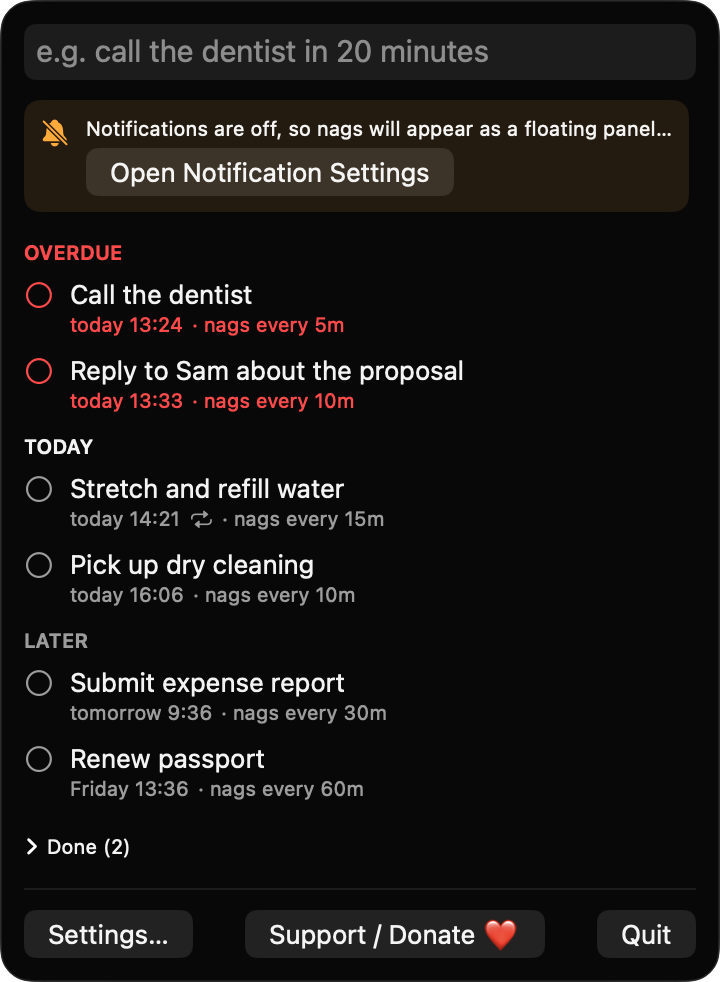
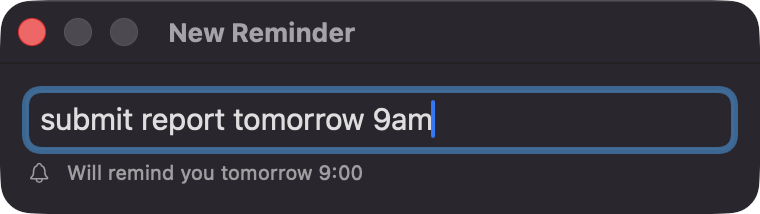
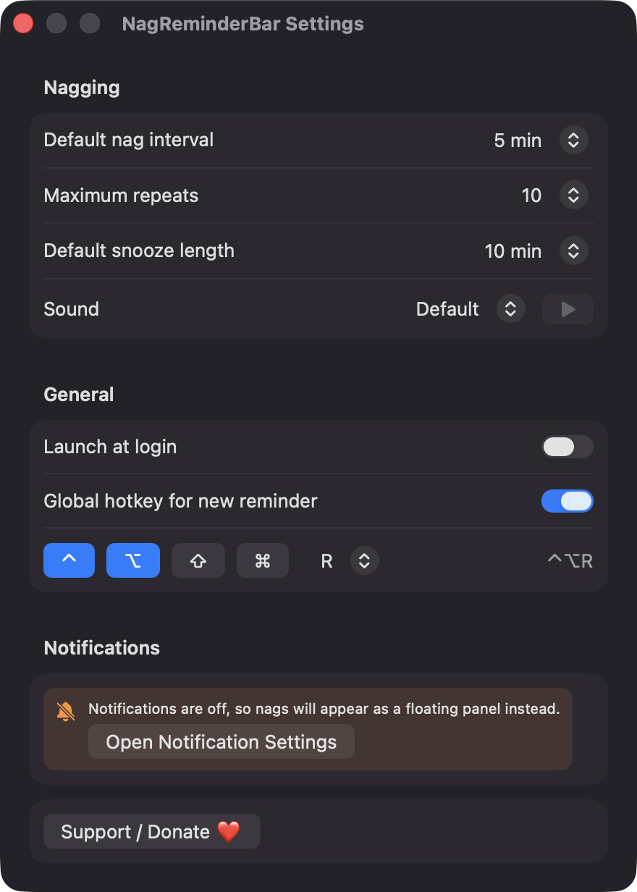
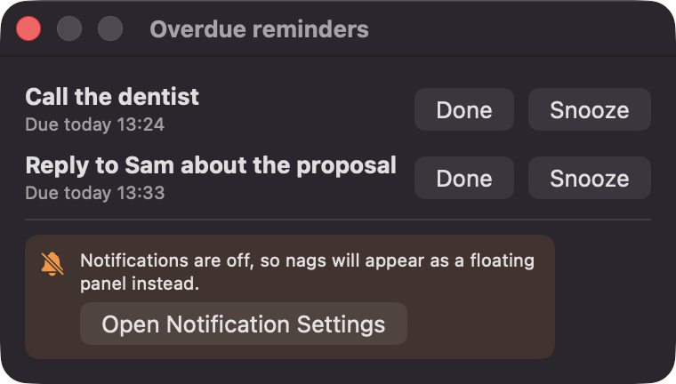

# NagReminderBar

**🌐 Website:** [turhe123.github.io/nag-reminder-bar](https://turhe123.github.io/nag-reminder-bar/)

Type a quick reminder in plain words and it keeps nudging you every few minutes until you mark it done.


## Why

NagReminderBar is a free, open-source, 100% native, backend-free alternative to paid utilities in the *Timers & Reminders* category. It was inspired by the "keep nagging me until it's done" idea popularised by apps such as Due ($14.99 one-time), and focuses on just that: fast typing and reminders that are hard to ignore. Everything runs locally on your Mac.

## Features

- **Menu bar app** with a single text field. The menu bar bell shows a badge with the number of overdue reminders.
- **Plain-language entry**: phrases like `call the dentist in 20 minutes`, `submit report tomorrow 9am` or `stretch every 2 hours` are parsed with `NSDataDetector` plus a hand-written relative-time parser.
- **Live preview** such as "Will remind you tomorrow 9:00 AM". If no time can be understood, a small date picker asks for one.
- **Auto-nagging**: an overdue reminder is re-delivered every 1, 5, 10, 15, 30 or 60 minutes (per reminder), up to a configurable maximum number of repeats (3, 5, 10, 20, 50 or unlimited).
- **Notification actions**: Done, Snooze (default 10 minutes, configurable) and Tomorrow.
- **Recurring reminders** (`every 2 hours`): completing one moves it to its next occurrence.
- **Grouped list** of Overdue, Today and Later, with a check button and a context menu: Edit, Snooze, Change nag interval, Delete.
- **History** of the last completed reminders, with a "Clear history" button.
- **Global hotkey** (default ⌃⌥R, configurable) that opens a floating quick-entry panel.
- **Sleep/wake aware**: after the Mac wakes you get one catch-up notification instead of a burst.
- **Notifications denied?** An inline banner links to System Settings, and nags fall back to a floating panel.
- **Settings**: default nag interval, maximum repeats, snooze length, alert sound (system sounds), launch at login, hotkey.
- Reminders are stored as JSON in `~/Library/Application Support/NagReminderBar/reminders.json`.

## Screenshots

<p align="center"></p>

<p align="center"><em>The menu bar window groups reminders into Overdue, Today and Later, each showing its due time and how often it will nag you.</em></p>

<p align="center"></p>

<p align="center"><em>Press ⌃⌥R anywhere to type a reminder in plain words a live preview shows exactly when you&#x27;ll be reminded.</em></p>

<p align="center"></p>

<p align="center"><em>Settings let you pick the default nag interval, maximum repeats, snooze length, alert sound, launch at login and the global hotkey.</em></p>

<p align="center"></p>

<p align="center"><em>When notifications are off, overdue reminders keep nagging in a floating panel with Done and Snooze buttons.</em></p>

## Install

1. Download `NagReminderBar-macOS.zip` from the [latest release](https://github.com/turhe123/nag-reminder-bar/releases/latest).
2. Unzip it and move `NagReminderBar.app` to `/Applications`.
3. Because the app is open source and not notarized, clear the quarantine flag:

   ```bash
   xattr -cr /Applications/NagReminderBar.app
   ```

4. Right-click the app → **Open** the first time.

## Build from source

Requires macOS 14+ and Xcode with Swift 5.9+.

```bash
brew install xcodegen
xcodegen generate
xcodebuild -project NagReminderBar.xcodeproj -scheme NagReminderBar -configuration Release -derivedDataPath ./build build
```

The app is produced at `build/Build/Products/Release/NagReminderBar.app`.

## Permissions

Based on the source, the app asks for very little:

- **Notifications** (alerts, sounds, badges): requested at first launch to deliver reminders and their Done / Snooze / Tomorrow actions. If you decline, the app falls back to a floating panel.
- **Login item** (optional): only if you turn on "Launch at login" (uses `SMAppService`).

It does **not** request Accessibility, Screen Recording, Microphone, Calendar/EventKit, Contacts or network access. The global hotkey uses Carbon's `RegisterEventHotKey`, which needs no Accessibility permission.

## Built with AI

NagReminderBar was written by [Claude Code](https://claude.com/claude-code) inside an automated pipeline, from a plain-English spec. No code, binaries or assets from any commercial app were used; it is a clean-room reimplementation of a feature set, not a copy.

What that means in practice:

- The full source is in this repo under the MIT license. Read it before you run it.
- No network calls, no analytics, no third-party dependencies. Only Apple frameworks.
- Ad-hoc signed and not notarized, which is why Gatekeeper warns on first launch.
- It has had less human review than a hand-written app. Bug reports and pull requests are welcome.

## Support ❤️

If this app is useful to you, you can support its development:

[Support Or (Leo) Davidai ❤️ on Ko-fi](https://ko-fi.com/leodavidai)

## License

MIT © Or Davidai Bachar
